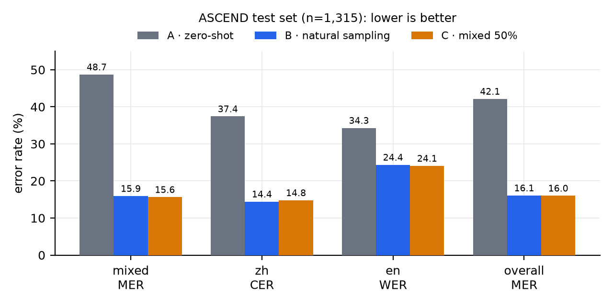
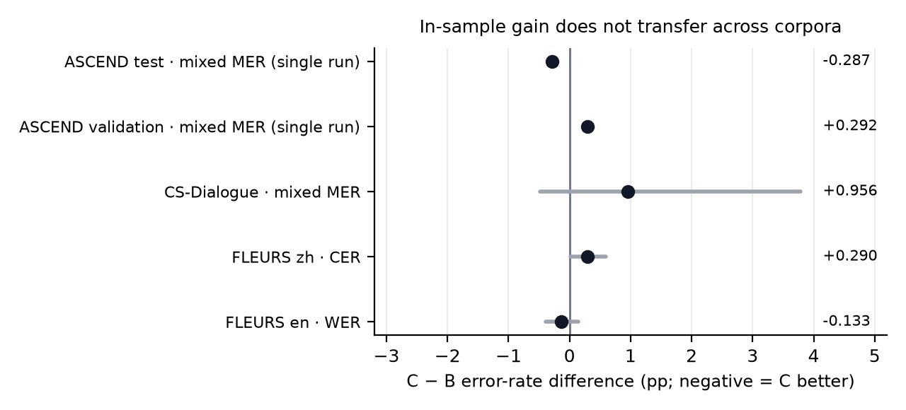

# Whisper-small LoRA 微调：ASCEND 中英混说语音（RTX 4060 Laptop 8GB）

本研究在 ASCEND 中英混说语音语料上以 LoRA 微调 Whisper-small，检验提高混合语种样本的采样概率能否优于自然采样。主指标为测试集 mixed 子集的 MER（编辑错误率）。实验协议在训练开始前冻结，数据来源与计分口径见 [`reports/protocol_sources.md`](reports/protocol_sources.md)。

## 1. 数据、组别、结论与对应文档

**数据**：ASCEND 论文作者发布于 Hugging Face 的 [`CAiRE/ASCEND`](https://huggingface.co/datasets/CAiRE/ASCEND)，固定 revision `737e9800ae31be9932ba8464c80366559bd28424`，共 12,314 条、10.62 h。该数据集自带 train / validation / test 三个划分（依次 9,869 / 1,130 / 1,315 条），本研究直接沿用，未重新切分；下文所述“训练集”“测试集”均指上述划分。

**mixed** 指同一句内中英混说（code-switching），为数据集 `language` 字段的一个取值，在 train 划分中 2,739 条，占 27.8%；另两个取值为 `zh` 与 `en`。

实验包含三个被比较的系统（A、B、C）与一次独立的可行性标定（pilot），定义如下：

| 组别 | 定义 | 训练量 |
|---|---|---|
| **A** | 原始 Whisper-small，零样本，不训练 | — |
| **B** | LoRA 微调，按训练集自然语种比例有放回抽样 | 800 次优化器更新 |
| **C** | LoRA 微调，mixed 采样概率提至 50%，其余设置与 B 相同 | 800 次优化器更新 |
| pilot | 50 步可行性标定，仅核查显存与时耗是否满足要求，不参与结论 | 50 次优化器更新 |

B、C 均从同一基础模型出发，LoRA 初始化一致，C 不接续 B 的训练状态。每组 800 次优化器更新对应 800 × 8 = 6,400 次样本抽样；因有放回，去重后的独立样本数为 B 4,698 条、C 4,437 条。

| 主题 | 结论 | 展开 |
|---|---|---|
| 测试集主结果 | 整体 MER 从 42.141% 降到 16.067%（B）/ 16.008%（C）；C 比 B 的 mixed MER 低 0.287pp，中文 CER 高 0.353pp | 第 2 节 · [FINAL_REPORT](reports/FINAL_REPORT.md) §3 · [RESULTS](reports/RESULTS.md) |
| 稳定性边界 | 验证集 mixed 方向相反（B 19.854% → C 20.146%，+0.292pp）；单种子、无显著性检验 | [FINAL_REPORT](reports/FINAL_REPORT.md) §4 |
| 实验协议与冻结变量 | 采样分布是唯一预设变量；步数、学习率、LoRA、种子在训练前冻结 | [EXPERIMENT](reports/EXPERIMENT.md) |
| 数据与计分口径 | 沿用数据集自带划分；MER 按中文计字、英文计词混合计数 | [protocol_sources](reports/protocol_sources.md) · [FINAL_REPORT](reports/FINAL_REPORT.md) §2 |
| 错误分析 | 40 条 C mixed 逐条文本复核：12 条零编辑错误、28 条有错；是 AI 文本对照，不是真人听音 | [ERROR_ANALYSIS](reports/ERROR_ANALYSIS.md) |
| 代码审查与修复 | 4 项确认问题全部关闭、17 项测试通过；权重、预测与评分未因此改变 | [REVIEW_FIXES](reports/REVIEW_FIXES.md) |
| 交付核验 | 隔离解压（禁用 GPU、断网）下 17 项测试、101 个文件哈希、CPU 精确复算通过 | [VERIFICATION](reports/VERIFICATION.md) · [REPRODUCE](reports/REPRODUCE.md) §5 |
| CS-Dialogue 外部验证 | 450 条域外混合语音：A 26.181%、B 12.275%、C 13.231%，C 未复现过采样优势 | 第 3 节 · [EXTERNAL_EVAL_REPORT](reports/EXTERNAL_EVAL_REPORT.md) |
| FLEURS 单语保留 | 中文 CER 降约 8pp；英文 WER 分别 +1.047、+0.914pp | [EXTERNAL_EVAL_REPORT](reports/EXTERNAL_EVAL_REPORT.md) |
| 复现与操作 | 四种使用方式、完整命令序列、续跑语义与交付校验 | [REPRODUCE](reports/REPRODUCE.md) |

## 2. 主要结果

测试集 1,315 条（mixed 373、中文 685、英文 257）。单位是百分比，越低越好；差值一律为**绝对百分点（pp）**。

| 组别 | mixed MER | 中文 CER | 英文 WER | 整体 MER | 崩溃率 |
|---|---:|---:|---:|---:|---:|
| A 原始 Whisper-small | 48.706 | 37.414 | 34.290 | 42.141 | 0.152 |
| B 自然采样 LoRA | 15.918 | 14.422 | 24.356 | 16.067 | 0.000 |
| C mixed 过采样 LoRA | 15.631 | 14.775 | 24.062 | 16.008 | 0.000 |
| C−B | −0.287pp | +0.353pp | −0.294pp | −0.060pp | 0pp |

- 指标口径：MER = 编辑错误数 ÷ 参考计分单位数，中文按字、英文按词混合计数；CER 只统计纯中文子集（按非空白字符）；WER 只统计纯英文子集（按英文词）。`jiwer.mer` 不是本实验的 MER。
- pp 与百分比的差别：15.918% → 15.631% 是 **−0.287pp**（约 −1.8% 的相对变化），不是“降低 0.287%”。

**结论**：预设方向性门槛通过，但效应量很小：mixed 子集净减少 16 个编辑错误，整体净减少 7 个；验证集 mixed 子集方向相反（B 19.854% → C 20.146%）。局限见第 5 节。

图 1：测试集错误率（%，越低越好）。mixed 与整体为 MER，中文为 CER，英文为 WER；C−B 依次为 −0.287、+0.353、−0.294、−0.060 pp。

### 2.1 实际训练设置

下表数值均由 `config.json`、`artifacts/` 下的产物与训练日志导出。两组唯一差异为 mixed 的采样概率。

| 项目 | 实际取值 | 出处 |
|---|---|---|
| 数据池 | train 划分 9,869 条 / 8.775 h：mixed 2,739（27.8%，3.617 h）、中文 4,799（48.6%，3.505 h）、英文 2,331（23.6%，1.653 h） | `artifacts/data_audit.json` |
| 实际入模条数 | 800 步 × 每步 8 条 = **6,400 次抽样**；有放回采样，去重后 B 4,698 条、C 4,437 条。B 抽到 mixed 1,812 / 中文 3,085 / 英文 1,503（28.3 / 48.2 / 23.5%）；C 为 3,220 / 2,147 / 1,033（50.3 / 33.5 / 16.1%） | `artifacts/{B,C}/sampling.json` |
| 语音时长 | 两组补齐输入相同：800 × 8 × 30 s = **53.33 h**；其中真实语音 B 5.681 h、C 6.531 h | 同上 |
| LoRA 作用位置 | `q_proj`、`v_proj`：encoder 12 层 self-attn、decoder 12 层 self-attn 与 cross-attn，共 72 个模块 / 144 个张量；rank 8、alpha 16、dropout 0.05 | `config.json`、`artifacts/{B,C}/adapter/adapter_model.safetensors` |
| 可训练参数 | **884,736**（占 241.73M 基座权重的 0.366%），B/C 相同 | `artifacts/{B,C}/initialization.json` |
| 优化 | AdamW，lr 1e-4，线性衰减 + 50 步 warmup，weight decay 0.01，梯度裁剪 1.0，每组 800 次优化器更新，seed 42 | `config.json`、`asr.py` |
| 显存与精度 | fp16 autocast + GradScaler；microbatch 1 × 梯度累积 8；启用 gradient checkpointing（non-reentrant） | `config.json`、`asr.py` |
| 显存峰值 | B allocated 1,134.6 MiB / reserved 1,278 MiB；C 1,136.4 / 1,270 MiB | `artifacts/training_summary.json` |
| 训练耗时 | 单步中位数 B 8.73 s、C 2.48 s；按每步日志累加 B 2.02 h、C 0.55 h | `evidence/logs/B_train*.log`、`evidence/logs/C_train.log` |
| 语言前缀 | mixed 与中文都喂 `zh` 语言 token，英文喂 `en`；task 固定 `transcribe`；训练与推理读同一份映射，不存在训练用中文前缀、评测换标签的情况 | `config.json`、`asr.py` |

两处指标的量测范围如下：

- **显存**：PyTorch 进程的 `max_memory_allocated/reserved` 峰值，不含驱动、桌面和其它进程；B 训练期间全卡占用约 6.4 GiB。
- **时耗**：B 经历一次中断与两次续跑，墙钟 2 h 13 min，同期存在其它 GPU ASR 与视频转码进程；B 最后 300 步平均 2.80 s/步。两组的每步时耗不用于性能比较。

## 3. CS-Dialogue 外部混合语音验证

为检验结论的跨语料可迁移性，将 A、B、C 三个模型用于未参与训练与选模的 CS-Dialogue 混合语音子集。该子集含 450 条混合短句、30 位官方测试说话人，共 100.2 分钟音频；不重新训练，直接加载 B、C 第 800 步的 adapter 推理。

| 组别 | mixed MER | 相对 A | 异常样本 |
|---|---:|---:|---:|
| A 原始 Whisper-small | 26.181% | — | 3/450 |
| B 自然采样 LoRA | **12.275%** | −13.906pp | 2/450 |
| C mixed 过采样 LoRA | 13.231% | −12.950pp | 3/450 |
| C−B | +0.956pp | 95% 区间 [−0.480, 3.781] | — |

- **微调收益可迁移**：B、C 在该域外混合语音上分别比原模型降低 13.906 与 12.950 个百分点。
- **过采样优势未迁移**：C 比 B 高 0.956pp，配对区间跨 0；方向与 ASCEND 测试集（C 低 0.287pp）相反，两次差异均在 1pp 以内。
- **计分口径**：MER 沿用本项目 ASCEND 作者兼容口径，非 CS-Dialogue 论文的原生评测程序，两者数值不可直接比较。
- **异常输出**：重复、截断至上限、正文前的语言前缀标记三类异常，A、B、C 分别为 3/450、2/450、3/450。
- FLEURS 中文与英文的单语保留结果、配对区间及数据许可边界见 [EXTERNAL_EVAL_REPORT](reports/EXTERNAL_EVAL_REPORT.md)。

图 2：C−B 的错误率差（pp，负值表示 C 更好）。ASCEND 两行为单次运行的即时值，无区间；其余三行为 2000 次配对分组自助法的 95% 区间，均跨 0。

## 4. 复现与操作

四种执行方式（只读结果、CPU 复算、重新生成、从头重训）、完整命令序列、中断与续跑语义、缓存身份不匹配的处理，以及交付内容与校验，见 [reports/REPRODUCE.md](reports/REPRODUCE.md)。

## 5. 局限

- **单随机种子**：每组只跑一次（seed 42），没有多种子复现、显著性检验或置信区间。
- **效应量小**：mixed 子集净减少 16 个编辑错误，整体净减少 7 个；验证集 mixed 子集方向相反（B 19.854% → C 20.146%）。
- **输入预算按补齐秒数匹配**：每步 8 条 × 30 秒补齐，不是真实语音秒数；C 实际多约 0.850 h 语音，暴露量差异与采样比例混在一起。
- **测试集参与决策**：测试集用于 B→C 的进入门槛，存在选择偏差；0.3pp 是事先约定的容忍范围，不是统计噪声界。
- **解码给定语言标签**：mixed 与中文用 `zh`、英文用 `en`，是 oracle 设置，不评估自动语言检测。
- **错误分析是文本对照**：40 条由 AI 读文本归类，未听音；音近字与疑似翻译的成因只标“疑似”。
- **计分口径**：ASCEND 作者兼容的对称标点清理、小写与 jieba 分词，保留语气词与重复；未做繁简转换或数字展开。
- **与论文不可直接对比**：论文 27.05% 的测试 MER 出自 wav2vec 2.0；A 是本项目实测的 Whisper-small 零样本基线。
- **硬件指标的范围**：显存为 PyTorch 进程峰值；时耗受同期共享负载影响，不反映采样策略的开销。
- **外部验证只覆盖子集**：CS-Dialogue 450 条、FLEURS 各 300 条，区间不含训练随机性；CS 的逐条参考与预测受许可限制，不随公开包分发。
- **未覆盖**：SenseVoiceSmall 对比、40% 敏感性组、真人听音、部署端自动语言检测。
